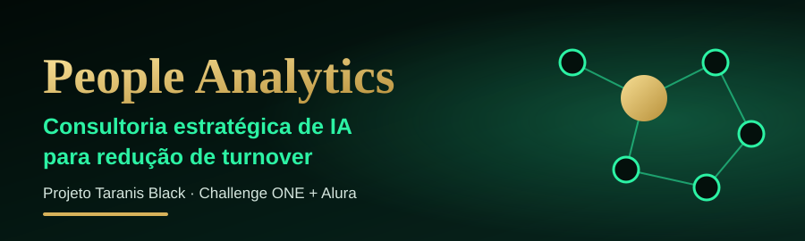

<p align="center">
  
</p>

<p align="center">
  <a href="analise-dados/analise_people_analytics.py"></a>
  <a href="analise-dados"></a>
  
</p>

Proposta de consultoria de IA para reduzir o **turnover** (rotatividade) e recuperar o clima de uma empresa fictícia, garantindo que a **decisão final seja sempre humana** e a **conformidade com a LGPD**.

## 🎯 Visão geral do desafio

A **Taranis Black**, empresa fictícia de ergonomia corporativa com 280 colaboradores, enfrenta desafios críticos:

- **24% de turnover** nos primeiros 90 dias.
- Queda do **eNPS de +62 para +28**.
- Causa raiz identificada: líderes recém-promovidos com dificuldade em conduzir conversas difíceis e dar feedbacks estruturados.

## 🛠️ Soluções propostas (matriz esforço × impacto)

| # | Iniciativa | Tipo de IA | Esforço × impacto | Onde encontrar |
|---|---|---|---|---|
| 1 | Alerta de risco de turnover | Preditiva | Alto impacto, baixo esforço (vitória rápida) | [analise-dados/](analise-dados) |
| 2 | Simulador de feedback (modelo SBI) | Generativa | Alto impacto, alto esforço (aposta estratégica) | [simulador-feedback/](simulador-feedback) |
| 3 | Mapeamento de perfis de liderança | Tradicional / ML | Baixo impacto, baixo esforço (melhoria contínua) | [docs/](docs) |

## 📈 Principais resultados e análise de dados

Uma análise em Python mostrou que **72% dos desligamentos** estão ligados a falhas de gestão, metas confusas e sobrecarga de trabalho, principalmente nos departamentos de **Suporte ao Cliente** e **Comercial B2B**.

- **ROI estimado:** cerca de **314%**, com economia projetada de aproximadamente **R$ 82.900 por ano** com a retenção de talentos críticos.
- **Governança e LGPD:** princípios de IA responsável, com a tecnologia atuando só como apoio à decisão humana (Art. 20 da LGPD).

## 📂 Estrutura do repositório

```text
people-analytics-taranis-black/
├── analise-dados/        # Scripts Python, base de dados fictícia e gráficos
├── simulador-feedback/   # Prompts e personas do simulador de feedback (SBI)
├── docs/                 # AI Canvas, ROI, plano de mudança e políticas de IA
└── README.md             # Documentação principal
```

---

*Projeto educacional (Challenge ONE + Alura). Empresa, pessoas e dados são fictícios. Nenhuma informação real é usada neste repositório.*

**Autoria:** Luana Ferreira de Sousa · [LinkedIn](https://www.linkedin.com/in/luaferreira-desousa/)
